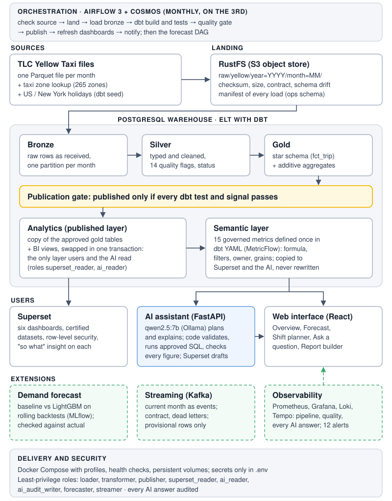
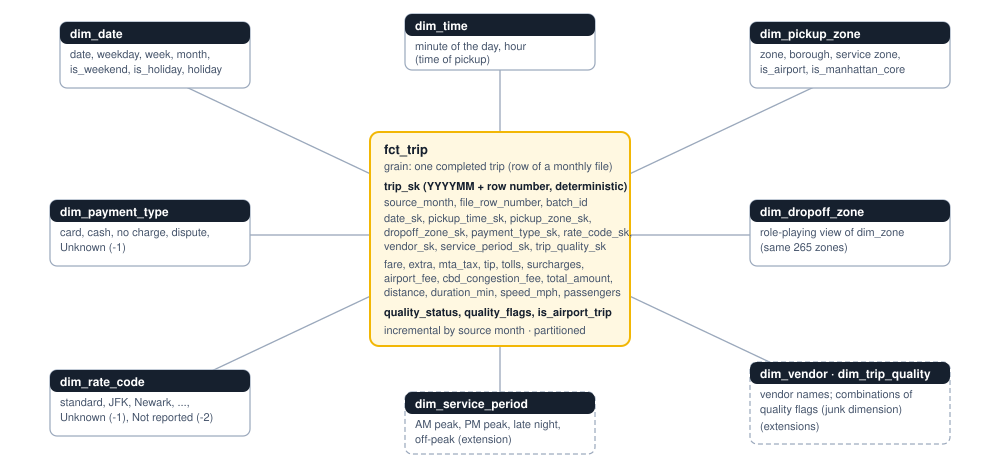
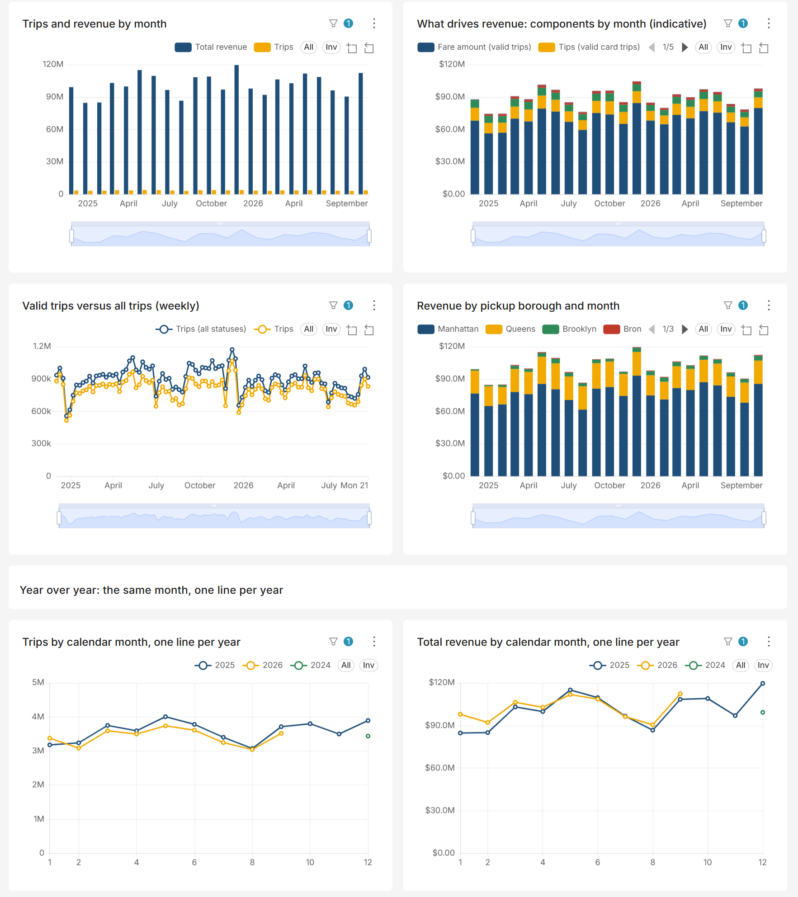
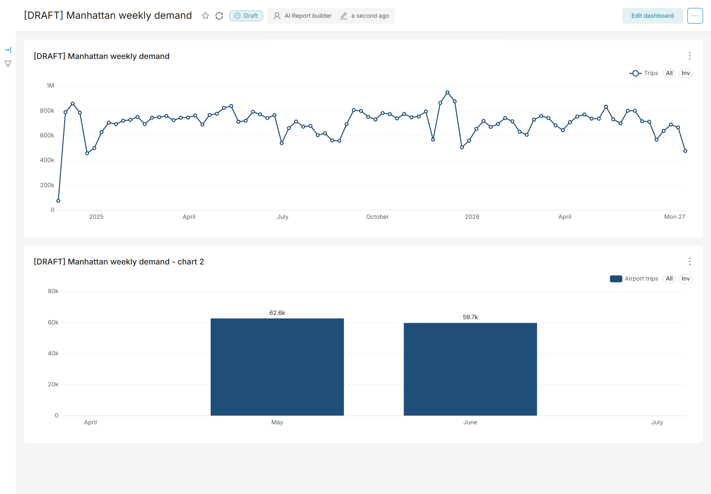
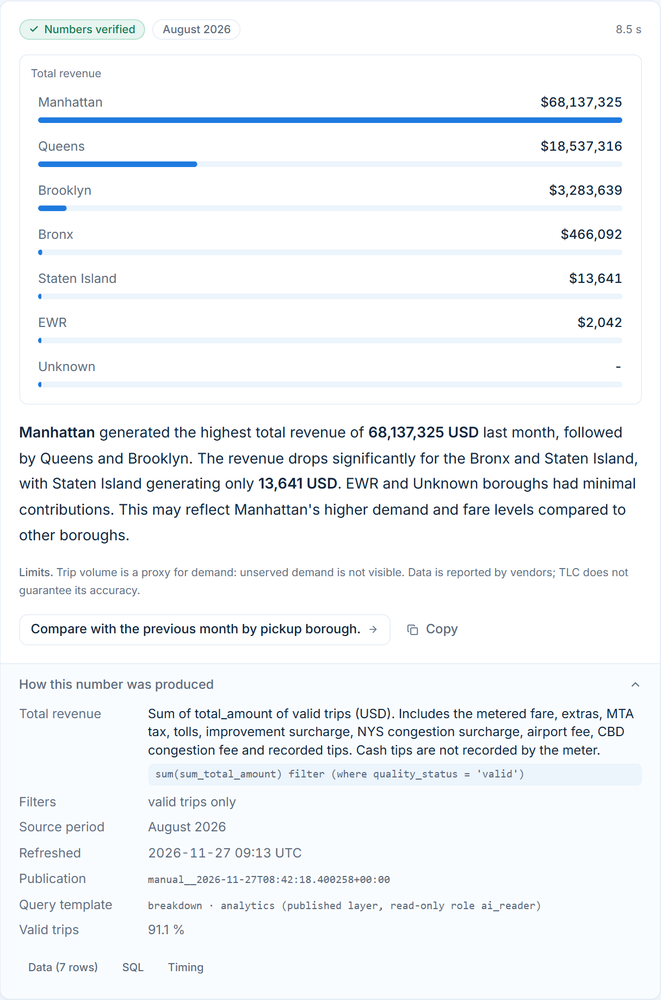
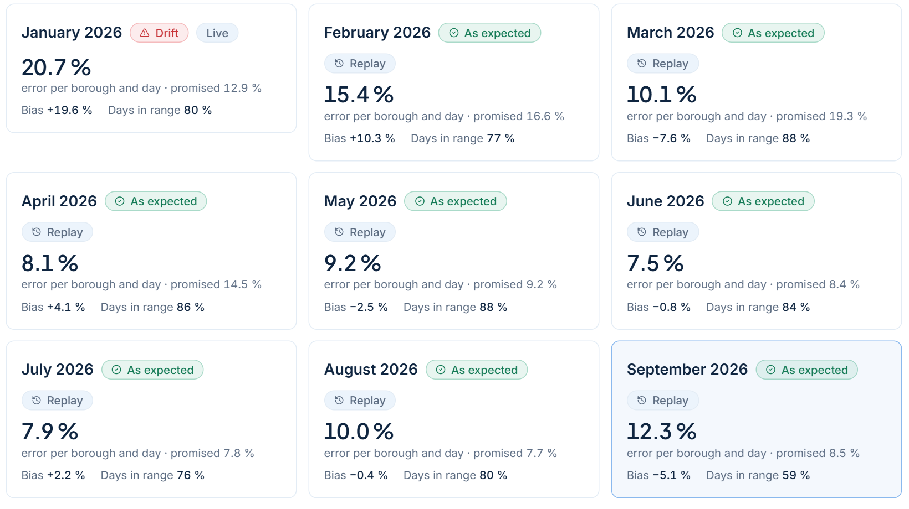

<div class="cover">
<div class="cover-top">ACADEMIC CITY UNIVERSITY<br>Faculty of Computational Sciences and Informatics</div>
<div class="cover-course">DS6102 · Data Warehousing and Information Retrieval<br>End of First Semester 2026/2027</div>
<div class="cover-title">NYC Taxi Insight Hub</div>
<div class="cover-sub">A trusted data warehouse, BI and AI analytics platform<br>for MetroMove Analytics on NYC TLC Yellow Taxi data</div>
<div class="cover-meta">
<p><strong>Student</strong> AYEBIE GRAM MESCHAC</p>
<p><strong>Roll number</strong> 2000250045</p>
<p><strong>Lecturer</strong> Jeremiah Ishaya</p>
<p><strong>Submitted</strong> November 2026</p>
<p><strong>Repository</strong> github.com/GRAMAYEBIE/Data_warehousing_retrieval_project</p>
</div>
</div>

## Summary

MetroMove's managers receive a monthly file of about four million taxi trips but cannot tell
quickly whether demand is changing, which zones need attention, what drives revenue, or
whether an odd fare is a data error. This project builds the first near-production version
of **NYC Taxi Insight Hub**: one platform that loads each monthly file, checks it, turns it
into one trusted set of figures, shows them in six dashboards and lets a manager ask
questions in plain English to an AI assistant that can only use those approved figures.

The platform runs entirely in Docker on one machine: an S3 landing zone, a PostgreSQL
warehouse in bronze, silver, gold and analytics layers built with dbt, Apache Airflow for
monthly orchestration, a governed semantic layer of 15 metrics, Apache Superset, and a
FastAPI and React assistant driven by a local model through Ollama. Two extensions go
further: a demand forecast tracked in MLflow and checked against reality every month, and
a Kafka stream that shows the current month before its official file.

**Key results.** Every row and every cent of each raw file is accounted for in the cleaned
layer; a figure can be traced from its row in the Parquet file to a chart or an AI answer.
40 of 40 metric checks give the same value in dbt, Superset and the assistant's SQL. The
assistant passes 20 of 20 evaluation cases and never runs SQL written by the model. A
failed run never changes what users see. The demand forecast learns from its own errors:
replayed over the last six months, its error per borough and day fell from 11.4 % to 9.2 %.

<div class="toc" markdown="1">

**Contents.** 1 Introduction · 2 Problem and success measures (Q1) · 3 Architecture ·
4 Ingestion and bronze (Q2) · 5 Medallion and data quality (Q3) · 6 Star schema and dbt
(Q4) · 7 Orchestration and reliability (Q5) · 8 Semantic layer (Q6) · 9 Superset and the
six dashboards (Q7, Q13) · 10 AI report builder (Q8) · 11 Natural-language questions (Q9) ·
12 Evaluation and testing (Q10) · 13 Security and governance (Q11) · 14 Containers and
project quality (Q12) · 15 Extensions: forecast and streaming · 16 Results, limits and
next steps · References

</div>

## 1. Introduction

**Context.** The NYC Taxi and Limousine Commission (TLC) publishes Yellow Taxi trip records
every month as Parquet files, about two months after the month ends. Each row is one
completed trip: pickup and drop-off times and zones, distance, fare components, payment
type, rate code and passenger count. The data is reported by vendors and TLC does not
guarantee its accuracy, so data quality is treated as a real business risk, not a detail.

**Objective.** Turn this open data into trusted business insight: every number shown must be
traceable from the raw file through bronze, silver and gold, to its metric definition and
the final chart or AI answer.

**Scope.** Twenty-two months, December 2024 to September 2026, the latest file the TLC had
published in November 2026; the 265 taxi zones; US and New York public holidays. The months
were loaded **in order, one Airflow run each**, as they would arrive in production: the
platform was first built on six months (December 2024 to May 2025, also the default of the
one-command demonstration), June 2025 was then streamed through Kafka before its official
load, and the fifteen following months were published one by one, each one checking the
forecast made for it. October 2026 will be loaded by the monthly schedule when the TLC
publishes it. The platform does not measure driver earnings, rider identity, waiting time,
cancellations, real emissions or profitability: the data cannot support them.

**Method.** The platform was built in eight waves, each leaving a working system: ingestion,
dbt, Airflow, semantic layer and Superset, AI assistant, observability, forecasting, and
streaming. Each claim in this report points to code, logs or tests in the repository.

## 2. Problem definition and success measures (Q1)

The full proposal is `docs/proposal.pdf` (two pages, written for both the client and the
technical team). Its content in short:

**Problem and decisions.** Each team cleans the monthly file its own way, so the same
question gets different answers and no one can say where a number came from. The platform
serves operations leaders (**capacity planning**: where and when to place taxis), city
planners (**zone monitoring**: which zones gain or lose trips, and when a trend breaks),
commercial analysts (**fare-policy review**: effect of the congestion fee introduced on 5
January 2025, airport fees, revenue per mile, tips) and the data team (**quality triage**:
is an unusual fare a data error or a real event?).

**Why the warehouse, governed metrics and BI come before the assistant.** An assistant is
only as trustworthy as the numbers beneath it. The warehouse keeps one reconciled copy of
every trip; governed metrics give each measure one written definition used by every tool;
dashboards let managers see and question these figures; only then does the assistant
choose which approved measure answers a question and explain the result. Starting with the
AI would let it invent definitions and give figures that do not match the dashboards.

| Area | Success measure and target | Measured |
|---|---|---|
| Data freshness | A month published within 24 h of its TLC file; publication date shown on every answer | Median 20 min from the source check to publication (26 runs, longest 34 min) |
| Data quality | Valid-trip rate ≥ 85 %; 0 unexplained rows between raw and cleaned data; 0 failed blocking test before publication | 83.6 % to 94.1 % per month, under target once (November 2025, section 5); 0 unexplained rows in 86 million; publication refused on a failed test |
| Dashboard usefulness | Every chart answers a named business question; 100 % of charts return data; same metric, same value in every tool | 6 dashboards, 57 charts, all returning data; 40 of 40 metric checks identical |
| AI trustworthiness | 100 % of figures in an answer come from an approved query; ≥ 90 % of evaluation cases pass; 0 model-written SQL executed | 20 of 20 cases pass; a text with a figure not in the result is replaced |
| Delivery reliability | ≥ 95 % of monthly runs succeed without manual action; a failed run never changes published data | 26 of 26 runs on the lab machine; a failed run tested: published data unchanged; the stack came back alone after two host restarts |

**Risks needing human review**: source-data quality (9 to 16 % of rows without payment type
or rate code, impossible values); LLM-generated insight (a misread question, a true figure
given to the wrong month, a guess presented as a cause); trips as a proxy for demand
(unserved demand is invisible); changes in the source schema; association mistaken for
cause.

## 3. Architecture

The design follows one rule: **users only ever read data that passed every check.** Raw
files land untouched in an S3-compatible object store: **RustFS**. The exam recommends
MinIO and accepts an equivalent with a written justification. This project uses RustFS
from the start because MinIO's community edition is no longer a maintained option: it
stopped publishing binaries and container images in October 2025, went into maintenance
mode in December 2025, and its repository was archived (read-only) on 25 April 2026 [3, 4].
A platform meant to be run again by others needs a maintained image. PostgreSQL holds the layers as
schemas: bronze (as received), silver (typed and flagged), gold (star schema and
aggregates) and analytics, a copy of the approved gold tables written by a separate
publication task only when the whole dbt build is green. Superset and the assistant can
read analytics only. Airflow runs the whole sequence each month. Each component runs in its
own container with a health check; everything starts with Docker Compose (Figure 1).

## 4. Source, ingestion and bronze layer (Q2)

**Source contract.** Monthly files at
`https://d37ci6vzurychx.cloudfront.net/trip-data/yellow_tripdata_{YYYY}-{MM}.parquet` (one
calendar month of pickups each, published about two months later), and the zone lookup CSV.
The expected columns are versioned in `ingestion/contracts/`: `yellow_v2024.yaml`, and
`yellow_v2025.yaml`, which adds `cbd_congestion_fee` from January 2025 (a real schema change,
verified: NULL for all 3,668,371 rows of December 2024, filled for all 3,475,226 rows of
January 2025). Schema drift is detected by comparing the file schema with the contract and
storing a SHA-256 hash of its columns and types. Usage: public data from NYC Open Data.

**Landing, bronze and manifest.** The landing step downloads the file, checks the Parquet
signature, size and SHA-256, and stores it under `raw/yellow/year=YYYY/month=MM/`. The
bronze load reads the file back from the landing zone and replaces the month's partition in
one transaction, keeping the source columns as published plus `source_month`,
`file_row_number` (the technical identifier: row N of the file), `batch_id`, `source_file`,
`ingested_at` and `schema_hash`. Raw values stay recoverable: wide types, nothing corrected.
`ops.ingestion_manifest` records one row per attempt: status, row counts in the file and in
bronze, schema version and hash, drift report, timestamps and errors.

| Situation | Behaviour (evidence in `docs/evidence/q02/`) |
|---|---|
| Successful run | 2024-12 loaded: 3,668,371 rows in the file and in bronze |
| Safe re-run | 2025-01 again: same checksum, `skipped_unchanged` in 4 seconds |
| File missing | 2027-01: HTTP 403, status `failed` with the error, nothing changed |
| Source adds a column | unknown column kept in a JSON column with a warning; a missing required column or a wrong type stops the load |

<figure class="tall"><figcaption>Figure 1. Architecture (section 3): from the TLC file to dashboards and the AI assistant.</figcaption></figure>

## 5. Medallion architecture and data quality (Q3)

**Bronze** is immutable and source-aligned. **Silver** gives explicit types (timestamps in
New York local time, `numeric(12,2)` amounts, `smallint` codes) and evaluates 14 quality
flags, each with a severity: invalid (negative amount, pickup after drop-off, duplicate,
pickup far outside the file's month), suspicious (speed above 80 mph, distance above 200
miles, duration under 1 minute or over 6 hours, zero distance with a charge, missing or
unknown zone, unknown payment or rate code) and informative (cross-month trip, value not
reported, total different from the sum of its components). **Gold** holds the star schema
and additive aggregates built for decisions.

**Duplicates**: same vendor, pickup and drop-off times and zones, distance and total; the
first row of the file is kept and the others are flagged. **Invalid records are kept with
their flags, not deleted**: approved metrics use valid trips only, while Dashboard 5 shows
the anomalies. Silently removing rows would distort the valid-trip rate and hide problems.
Only rows that cannot be read at all go to quarantine.

Two decisions came from measuring the data. In January 2025, 15.5 % of rows have
`payment_type = 0` with no rate code or passenger count: they stay valid with a
"not reported" flag, because marking them suspicious would remove 12 % of revenue without
a business reason. And the total equals the sum of its components for 98.6 % of vendor 2
rows but only 9 % of vendor 1 rows (a reporting convention), so that check is informative
only and `total_amount` is the governed revenue measure.

| Source file | Bronze rows | Silver rows | Unexplained | Valid | Suspicious | Invalid | Valid-trip rate |
|---|---|---|---|---|---|---|---|
| 2024-12 | 3,668,371 | 3,668,371 | 0 | 3,435,481 | 153,480 | 79,410 | 93.65 % |
| 2025-01 | 3,475,226 | 3,475,226 | 0 | 3,177,890 | 152,379 | 144,957 | 91.44 % |

The bronze → silver reconciliation (`gold.recon_bronze_silver`) also matches every cent of
`total_amount` (gap 0.00) and is a blocking test: a gap stops publication. Over the 22
months, 86 million rows, none is unexplained. One month missed the 85 % target:
**November 2025, 83.6 %**, because one vendor, Curb Mobility, reported negative amounts on
12 % of its trips (9 % in October, 1 % in December; 0 % for the others). The rows stay,
flagged; the dashboards and every answer on that month show the warning. An alert per
vendor now flags such a month as soon as it is published (above 10 % invalid, or 3 points
above the vendor's usual level); on the history it also caught Creative Mobile sending ever
more duplicates, 0 in June 2026 to 25,349 (3.7 %) in September.

## 6. Dimensional model and dbt (Q4)

`fct_trip` has one row per completed trip. Its surrogate key is deterministic and readable:
`20250100001204` is row 1204 of the January 2025 file, identical after any reload, which
makes tracing a trip trivial. Every dimension has an "Unknown" member (`-1`), and the rate
code also "Not reported" (`-2`), so no trip is lost in a join. The full data dictionary is
`docs/data_dictionary.md`.

The dbt project (`dbt/`) has staging, intermediate (silver) and mart (gold) layers with:
source definitions and a freshness check on the ingestion manifest (warn after 45 days,
error after 75); tests of uniqueness, non-null keys, accepted values and relationships from
the fact to every dimension; three business assertions (no row lost between bronze and
silver; every valid trip respects the thresholds; every valid trip has a calendar date,
section 15); an incremental strategy by source month,
which rebuilds a month and its two neighbours (a trip can sit in the next month's file),
with a full refresh when a rule, a dimension or the contract changes; partitions and
indexes on the fact; documentation and lineage exported to `docs/dbt_docs/`; and reusable
macros, notably the quality-flag catalogue (each flag declared once, driving the status,
the flag list and the documentation) and safe casts that return NULL instead of failing.
First build: 94 of 94 steps passed. The first-ever build also produced a useful failing
test: the reconciliation test failed because December was in bronze but not in silver;
building the missing month fixed it.

<figure><figcaption>Figure 2. Star schema at the grain of one completed taxi trip (dashed: optional extensions).</figcaption></figure>

## 7. Orchestration, reliability and observability (Q5)

The Airflow DAG `monthly_yellow_pipeline` runs: resolve the month → check the source → land
in the object store → load bronze → anything new? → dbt build and tests (one Airflow task
per model, through Cosmos) → measure signals → quality gate and publish → refresh the
dashboards → record the outcome and notify. Every step is idempotent; retries use an
exponential delay, and the source check waits 6 hours for an unpublished file but retries
network errors within minutes. After a partial failure, only the failed task is cleared
and resumed, and **analytics keeps the previous publication until a run passes the gate**.
The schedule is the 3rd of each month; `max_active_runs = 1` prevents overlapping runs;
backfill is a manual run with a `month` parameter. Airflow 3 no longer has task SLAs, so
lateness is bounded and alerted in three ways: a run timeout (12 h) and per-task execution
timeouts; dbt source freshness on the ingestion manifest (warning after 45 days, error
after 75); and Prometheus alerts when the published data is older than 45 days, when a run
fails or when dbt tests fail.

| Run | Scenario | Outcome |
|---|---|---|
| First run | First task timed out (machine under load) | failed; nothing published; failure reported |
| Second run | A signal task failed on a time-zone bug, fixed and cleared | published; dbt not redone; 69 of 69 tests |
| Re-run of the same month | File unchanged | `nothing_new` in 1 min 21 s |
| New month under memory pressure | PostgreSQL crashed, then a test caught a missing dependency | the gate held each time; published after the fixes |

Five operational signals are written for every run: freshness, volume against the previous
month (more than 50 % blocks publication), rejected-row rate, late-data rate and dbt test
pass rate. They feed Dashboard 5 and Prometheus; Grafana shows the pipeline, the data age
and quality, and 15 alert rules cover stale data, low valid-trip rate, a vendor's data,
failed runs, the assistant, a drifting forecast and a lagging Kafka consumer.

## 8. Semantic layer and governed metrics (Q6)

Fifteen metrics are defined once, in dbt's semantic layer (`dbt/models/semantic/`): the 12
required (trips, total revenue, average fare, average tip, tip rate, average distance,
average duration, revenue per mile, trips per active hour, airport trips, congestion fee
revenue, valid-trip rate) plus airport fee revenue, congestion surcharge revenue and an
estimated CO₂ indicator, labelled as an estimate. Each carries its owner, formula, filters,
time grains and dimensions. Examples of explicit rules: tip rate and average tip use card
trips only (cash tips are not recorded); total revenue includes tolls, surcharges and
congestion fees; every metric except the valid-trip rate uses valid trips only. The
catalogue is `docs/metric_catalog.md`.

A small service copies each formula into Superset's certified datasets and into the
assistant's catalogue: nothing is rewritten by hand. A consistency test computes the
metrics month by month through MetricFlow on `fct_trip`, the published SQL the assistant
runs, and Superset's chart API: **40 of 40 values identical**, that is eight metrics (trips,
total revenue, average fare, tip rate, valid-trip rate, trips per active hour, congestion
fee revenue, estimated CO₂) over five pickup months, with a tolerance of one part in a
billion (`docs/evidence/q06/reconciliation.md`). For example, total revenue for January 2025
is **84,627,384.68 USD in MetricFlow, in the assistant's SQL and in the Superset chart**; the
same question asked to the assistant returns the same figure. Stated limitation: open-source MetricFlow cannot
be queried by Superset directly; the governed fallback is the copied formula, controlled by
this test.

## 9. Superset and the six dashboards (Q7, Q13)

Superset connects with the read-only role `superset_reader` to the analytics schema only,
through ten certified datasets that carry the governed metrics with their descriptions and
owners. A role "Analyst Manhattan" sees Manhattan only (row-level security). Dashboards are
built as code (`services/metrics_sync/dashboards.py`) and rebuilt after every publication.

| Dashboard | Strategic question | Highlights |
|---|---|---|
| 1 Executive Pulse | Are trips and revenue healthy? | week and month trends, revenue bridge (volume versus price effect), valid versus all rows, freshness |
| 2 Demand Rhythm | When should capacity increase? | hour × weekday heatmap, weekday / weekend / holiday, trips per active hour, peaks |
| 3 Geography and Routes | Where is the value moving? | map, top zones, growing and declining zones, routes by volume and revenue per mile |
| 4 Fare, Payment, Customer | What is changing in trip economics? | fare components, tip rate by payment type, card and cash shares, congestion fee |
| 5 Efficiency and Anomalies | Where should leaders look closer? | slow routes (robust z-score), suspicious rate by vendor and month, row counts per batch, "pause decisions" tile |
| 6 City and Airport Strategy | What action next? | airport mix, demand versus revenue, underserved zones (proxy), estimated CO₂, top three actions |

Every dashboard has global date and borough filters, cross-filters, a data-quality tile, a
"last refreshed" tile and a drill-down path from the executive KPIs to zone, hour, payment
type and route. It ends with a plain-English **"So what?"** block and a recommended next
question, computed from the published data at each refresh; a unit test checks that every
number quoted in these texts comes from a query. In total, 57 charts, each describing the
question it answers. **Year-over-year** comparisons, asked by Dashboard 1, became possible
once thirteen months were published: two charts draw each calendar month with one line per
year, and the "So what?" block compares the latest month with the same month a year
earlier. Screenshots of the six dashboards, their export and the metrics each chart uses
are in `docs/evidence/q07/`.

<figure><figcaption>Figure 3. Dashboard 1, Executive Pulse, after the September 2026 publication: months, revenue drivers, valid versus all trips, boroughs, and year over year (one line per year).</figcaption></figure>

## 10. AI report and dashboard builder (Q8)

A manager types a request such as *"Create a weekly demand report for Manhattan and add a
chart comparing airport trips this month with last month."* The model (`qwen2.5:7b` served
by Ollama) only fills a `ReportRequest` (intent, approved metrics, dimensions, filters, date range,
comparison period, chart, title, explanation), grounded by a compact catalogue of the
governed metrics, dimensions and examples. Pydantic validates its JSON; code then rejects
unknown metrics, invalid filters and dates outside the published months. The request is
resolved only through parameterised templates on analytics, and a draft chart and
dashboard are created through Superset's REST API, prefixed `[DRAFT]`.

The user sees the specification, a preview of each chart's data and a summary before
anything is published. **Publication needs explicit confirmation**: without
`confirm = true` the API answers HTTP 409 and the draft stays a draft. A request the data
cannot answer, such as *"a dashboard of driver earnings per shift"*, is rejected (HTTP 422)
with the reason. Every step is written to the audit log. Evidence:
`docs/evidence/q08/report_builder.md`; the draft built for the request above is Figure 4
(left).

## 11. Natural-language questions over the gold layer (Q9)

The flow is the one the exam describes, with code at every step that matters: the
question first goes through deterministic guards (unsupported topics, injection attempts);
the model returns a structured plan; code grounds it in the question (a period or a zone
named in the question must be in the plan, a filter the question does not mention is
removed), validates it against the catalogue and policy, and gives the model one chance to
repair a rejected plan; an approved template runs as `ai_reader` (read-only, 10-second
limit, row limit, allow-listed tables, SQL parsed by SQLGlot); the model explains the result
only; finally code checks every number of its text against the result, and also that a
figure is not given to the wrong zone, hour or month. Any failure replaces the text with a
factual summary written by code.

Sessions keep active filters, visible to the user, with a reset button; follow-ups change
only what they name. An extract of the evaluation transcript (`qwen2.5:7b`; a full session
with plans, guardrails, provenance and audit log is in `docs/evidence/q09/`):

> **Manager:** What was the tip rate in Brooklyn last month?
>
> **Assistant:** **20.4 %** was the tip rate for card trips in Brooklyn last month (April 2025). *[plan: tip_rate, pickup borough = Brooklyn, previous month; 7.5 s]*
>
> **Manager:** And for Queens?
>
> **Assistant:** **21.5 %** is the tip rate for card trips in Queens during April 2025. *[plan adjusted by code: measure and period kept from the previous question, borough replaced]*

Vague questions get a clarifying question, empty results an explanation, unanswerable
questions a refusal with the reason, and model downtime a clear message (HTTP 503). Every
answer cites the metric definition and formula, the months used, the publication and its
timestamp, the filters, the valid-trip rate of the period and the exact SQL run (Figure 4,
right).

**Three prompt variants** were compared on the evaluation pack (`qwen2.5:3b`, laptop CPU).
*Minimal* passed 15 of 16 cases: asked "How are we doing?", it guessed a five-metric
breakdown instead of asking what the manager meant. *Explicit rules* passed 13 of 16: the
same guess, and two time-outs from its length. *Structured examples* passed 16 of 16: it
asked a clarifying question and stayed within the catalogue, so it was kept. Questions
about next month are answered from the forecast, labelled as estimates (section 15).

## 12. Evaluation, safety and testing (Q10)

The evaluation pack `evals/cases.yaml` has 20 cases covering every category the exam lists:
normal questions, multi-turn follow-ups, ambiguous language, unsupported questions, an
empty result, a malicious instruction, an invalid date, conflicting filters, model failure
and a dashboard request. Each records the expected intent, metrics, filters and behaviour;
`make eval` runs them against the live API and writes the table to `docs/evidence/q10/`.

| Stage | Cases passed |
|---|---|
| First baseline (`qwen2.5:3b` on the laptop CPU) | 11 of 16 |
| After grounding the plan in the question | 15 of 16 |
| Final, `qwen2.5:7b` on the lab machine's GPU, 22 months (27 November) | 20 of 20 (median 8.6 s) |

**One observed failure and its fix.** *"What was the tip rate in Brooklyn last month?"*
was planned with a filter copied from a retrieved example (payment type cash) and without
Brooklyn. A better model was not the fix: code now applies the period named in the
question, removes any filter value the question does not name, and rejects a plan that
omits a named zone or borough, giving the model one repair. The case and its follow-up
*"And for Queens?"* now pass. Later guards came from real answers: "37.69 trips" written
for a percentage (the unit after each figure is now checked), and "20.7 % of card trips had
tips" for a tip rate, which is tips divided by the fare (the narrator now gets each
definition, and such a text is replaced; `docs/evidence/q09/`). Automated tests: 92 API
tests, dbt, ingestion, forecasting and stream tests, run by GitHub Actions on every push,
plus an end-to-end smoke test.

<figure class="pair"><div class="row"></div><figcaption>Figure 4. Left (Q8): the request of section 10 built as a [DRAFT] Superset dashboard, waiting for confirmation. Right (Q9): "What was the total revenue last month by pickup borough?", every figure checked against the result, then how it was produced: definition and formula, filters, period, publication, template and read-only role, valid-trip rate.</figcaption></figure>

## 13. Security, governance and ethical use (Q11)

Each component has its own PostgreSQL role with the least rights it needs: `loader` writes
bronze and the manifest; `transformer` builds silver and gold; `publisher` writes
analytics; `superset_reader` and `ai_reader` read analytics only (the assistant's role is
read-only with a 10-second limit and cannot read bronze, gold or the operational tables);
`ai_audit_writer` can only insert audit rows; `forecaster` and `streamer` write only their
own schemas. These rights were tested, not assumed. Passwords, tokens and model settings
live in `.env`, never committed; `.env.example` holds placeholders only.

Lineage runs from the file's checksum in the manifest to bronze rows, through dbt lineage,
to the published copy and the metric used by a chart or an answer. Users see metric
definitions in Superset tooltips and in every AI answer, and the valid-trip rate with a
warning below 85 %. The governance note (`docs/governance.md`) addresses misleading
conclusions from observational data, under-coverage and data errors, geographic fairness
(Yellow Taxi coverage is centred on Manhattan and the airports, so outer boroughs look
"underserved" partly because other services serve them), and the difference between a
proxy and a measured fact (trips are not demand; CO₂ is an estimate).

## 14. Containerisation and project quality (Q12)

One Docker Compose file runs every service: PostgreSQL, the object store, Airflow, dbt
execution, Superset with Redis, the API, the web interface, Ollama (or Ollama on the host,
used on the Apple-silicon lab machine for its GPU), MLflow, Kafka and the observability
stack. Services are grouped in profiles, have health checks, persistent volumes and
`depends_on` health conditions; one-shot jobs exit when done (all services healthy:
`docs/evidence/q12/`). **One command** starts a fresh clone:

```
python scripts/bootstrap.py all --months 2024-12..2025-05
```

It creates `.env` with random secrets (never overwriting an existing one), starts the services, loads the
zones and each month through the Airflow pipeline, builds the six dashboards, loads the
model and checks the assistant's health; each step can be run alone or again. The README
documents the steps and how to load a single demonstration month (`make ingest
MONTH=2025-01`). Resources: the platform was developed on an 8 GB
laptop (one month at a time, memory limits per service) and runs in full on a 16 GB machine.
The repository separates `airflow/`, `dbt/`, `app/`, `infra/`, `ml/`, `services/`, `docs/`
and `tests/`.

## 15. Extensions: forecasting and streaming

**Demand forecast.** Next month's trips and revenue are forecast per zone, day and hour,
always labelled as estimates. Three methods compete every month:

- the **seasonal baseline**: the zone's mean at that hour and weekday over the last four weeks;
- the **adjusted baseline**: the same, corrected per borough by the recent trend (last two
  weeks against the two before, halved, within ±10 %) and by that month's usual change a
  year earlier (within −20 % and +25 %);
- a **LightGBM** model: gradient-boosted trees with a Poisson objective (trip counts) and
  quantile models for the 80 % range, on calendar, profile, trend, last-year and
  last-month-error features.

They are scored on rolling backtests (each of the last three months forecast from the weeks
before it, never a random split) by the weighted absolute percentage error (WMAPE) per
borough and day, also per demand level so that busy Manhattan cannot hide the rest. A
challenger replaces the baseline only if it wins most months, on average and on the
busiest zones. Ranges are calibrated on the six previous months' errors; every run, with
its scores and the reason for its champion, is tracked in MLflow.

**Learning from its errors.** When a month is published, the job first checks its forecast
against what happened, then forecasts the next month. The gap is used three ways: last
month's error per zone and borough is a model feature; training weights favour recent
months (half-life six months, three after a drift, to forget an outdated pattern faster);
the champion is chosen again on fresh backtests. An error above 1.5 times and 3 points over
its promise is a drift, alerted in Grafana.

**A negative result, kept.** Correcting the baseline by last month's error made it worse
(14.5 % against 12.9 %): most monthly errors come from seasonal turns (back to school, the
holidays) that do not carry over, so that error stays a model feature only. The two-week
trend and last year's same month each helped (12.6 % and 12.5 %), hence the adjusted baseline.

**Results.** Each of the 18 months from April 2025 was replayed with the new code: forecast
again from the months before it only, then checked (Figure 5).

| Error per borough and day | Seasonal baseline alone | Champion chosen each month |
|---|---|---|
| 18 months, April 2025 to September 2026 | 12.4 % | 12.2 % |
| Last six months, April to September 2026 | 11.4 % | **9.2 %** |
| Summer 2026, July to September | 15.1 % | **10.1 %** |

The baseline was kept 10 times, the adjusted baseline chosen twice and LightGBM 6 times,
all since March 2026, once a full year of history gave it last year's same month. Five of
the first ten months drifted, on seasonal turns that four weeks of history cannot show;
none has since February 2026. The choice has a cost: in August 2025 and February 2026 the
adjusted baseline, better on its backtests, did worse on the month (16.7 % and 15.4 %
against 13.4 % and 10.8 %). Revenue tells the same story: 13.6 % to 11.2 % over the last
six months, no drift since February 2026. LightGBM made the October 2026 forecast.

<figure class="compact"><figcaption>Figure 5. Forecast against actual on the Forecast page: January 2026 (live check) drifted; every month since, replayed with the new code, came in as expected.</figcaption></figure>

**The check found a platform bug.** From February 2026 the forecast kept targeting the same
month: the dbt calendar ended on 31 January 2026, so later trips got the "Unknown" date and
vanished from the published views while every test passed. The calendar now runs to 2027,
and a new blocking test refuses a month in which a valid trip has no date; its first run
still caught one, a January trip that started at 00:45 on 1 February. A month with no
recorded trip is no longer checked (February had been, with an empty result).

**Streaming.** A Kafka stream replays the current month trip by trip before its official
file: a versioned contract sends malformed messages to a dead-letter topic (74 in June);
each trip is written once, provisional, never governed; consumer lag is alerted.

## 16. Results, limits and next steps

The platform meets its success measures: published data that passed every check, a
reconciled cleaned layer, dashboards that agree with the governed metrics, an assistant that
never invents a figure, and runs that fail safely. One target was missed, by the data, not
the platform: the valid-trip rate of November 2025, explained and flagged. Limits: trips
are a proxy for demand; vendor data has gaps; a language model can misread a question,
hence its plan, figures and sources always shown; the forecast still lags sudden changes;
one machine, without backups.

Building it also showed that a green test suite is not enough: the calendar gap of
section 15 passed every test and was found by the forecast check, a control on outcomes,
not on structure. Next steps: weather and event data for the forecast, the stream fed by a
live source instead of a replay, and a managed database and object store, with backups,
for several users.

## References

1. NYC Taxi and Limousine Commission, *TLC Trip Record Data* (files and zone lookup; NYC
   Open Data terms), https://www.nyc.gov/site/tlc/about/tlc-trip-record-data.page
2. NYC Taxi and Limousine Commission, *Data Dictionary: Yellow Taxi Trip Records*,
   https://www.nyc.gov/assets/tlc/downloads/pdf/data_dictionary_trip_records_yellow.pdf
3. MinIO, *minio/minio repository* (source only; archived on 25 April 2026),
   https://github.com/minio/minio
4. It's FOSS, *MinIO moves away from open source*,
   https://itsfoss.com/news/minio-moves-away-from-open-source/
5. dbt Labs, *dbt Semantic Layer and MetricFlow*, https://docs.getdbt.com/docs/build/about-metricflow
6. Apache Software Foundation, *Apache Airflow 3* and *Apache Superset* documentation,
   https://airflow.apache.org, https://superset.apache.org
7. Astronomer, *Cosmos: run dbt projects in Airflow*, https://astronomer.github.io/astronomer-cosmos/
8. Ollama, *qwen2.5 model library*, https://ollama.com/library/qwen2.5
